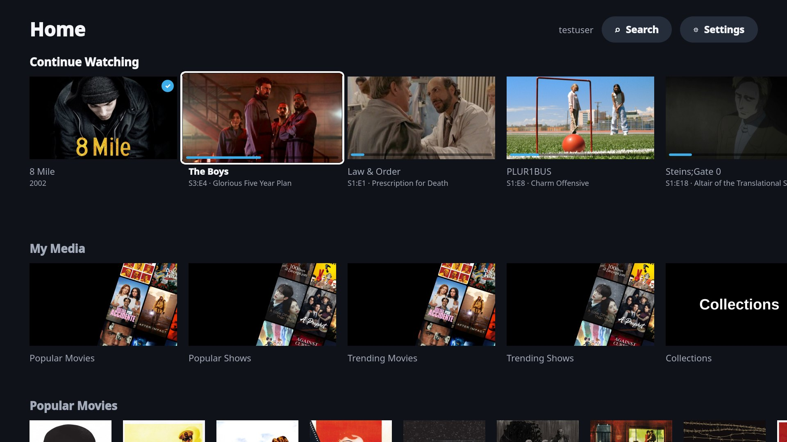
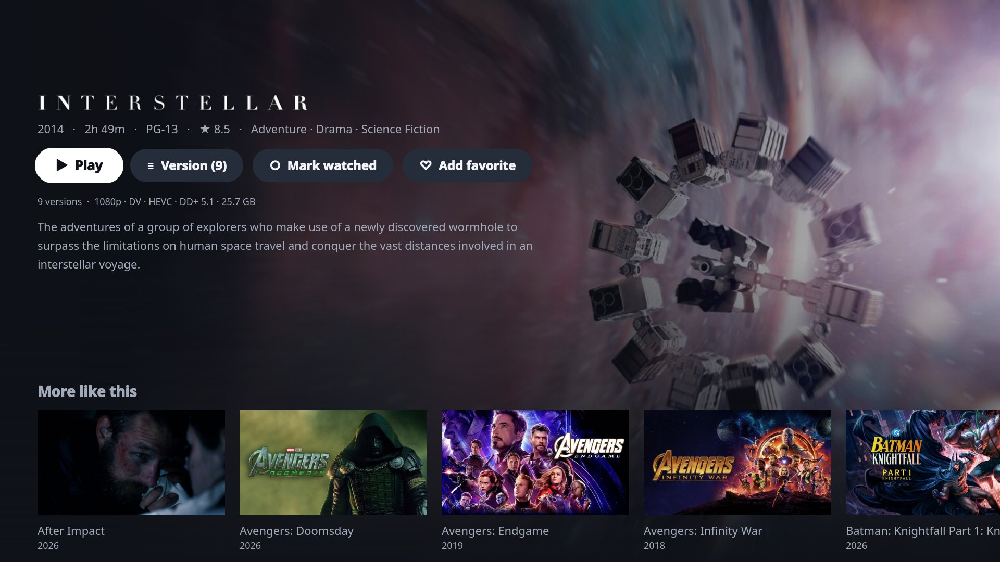
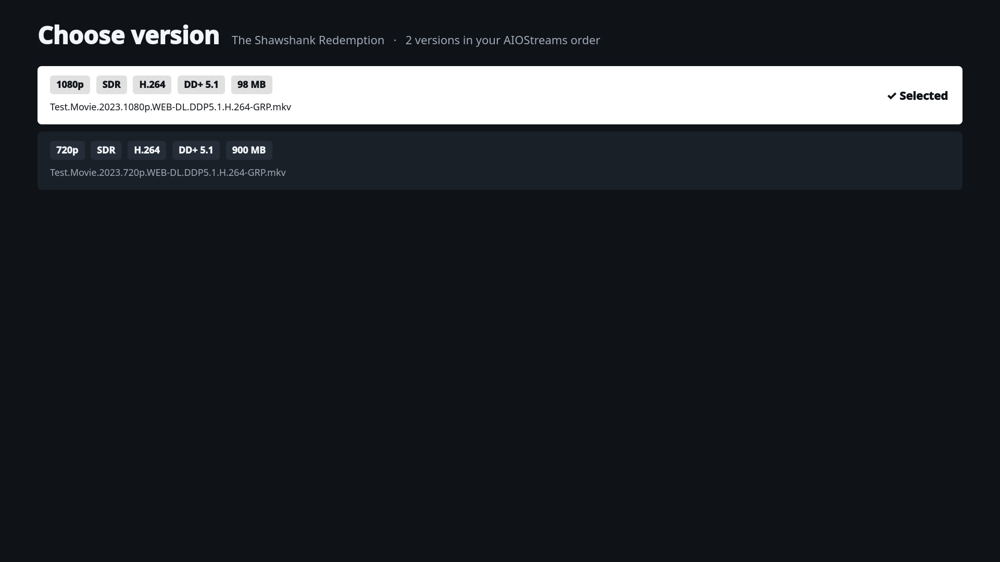
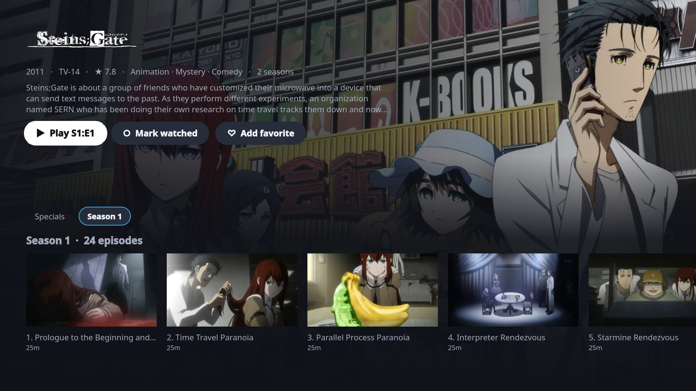
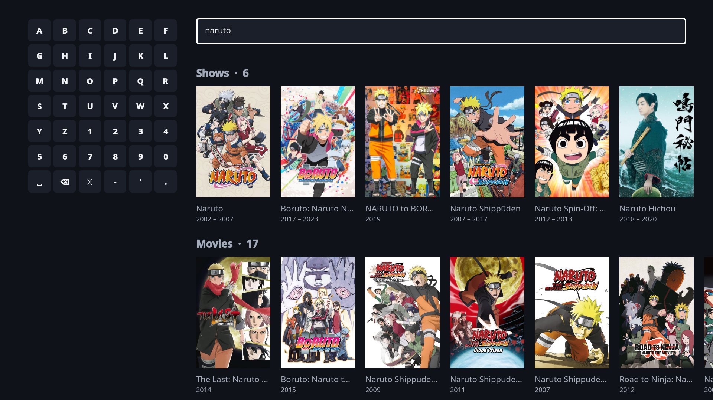
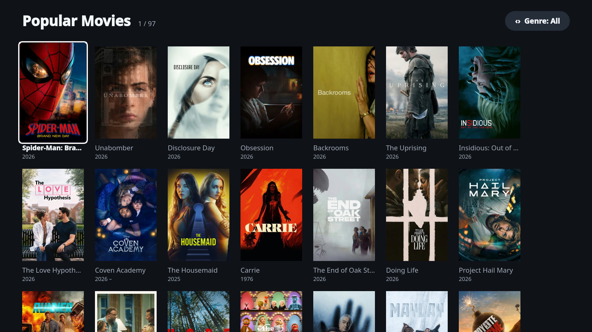
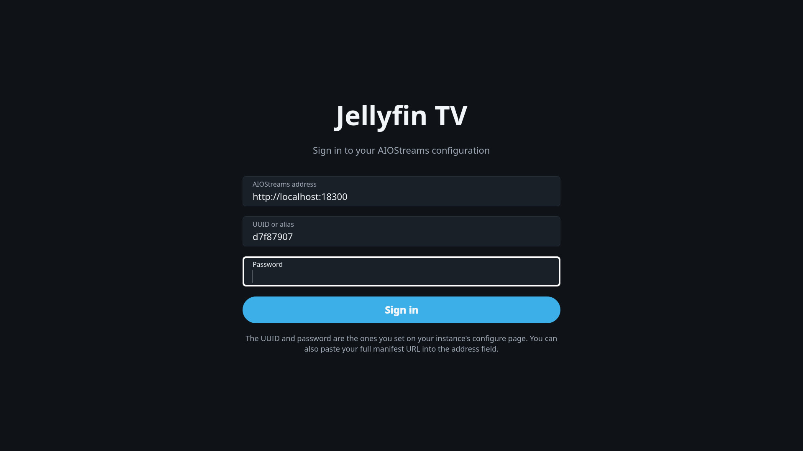
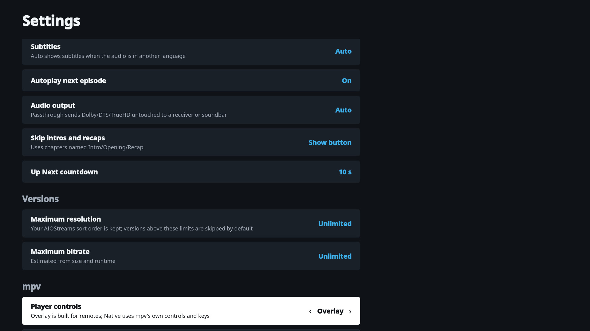

# AIOstreamer for Linux

A fast, native 10-foot client for [AIOStreams](https://github.com/Viren070/AIOStreams) on Linux TVs and HTPCs. Built with Qt Quick (QML on the GPU scene graph, no web view), driven entirely by a remote, gamepad or keyboard, and it hands playback to a fullscreen mpv so HDR and Dolby Vision output stays intact. On KDE it picks up your accent color through Kirigami.

It talks to your AIOStreams configuration directly: catalogs and metadata from the addons you set up there, streams sorted, filtered and formatted by your own AIOStreams rules, and subtitles from your subtitle addons. No Jellyfin server or Stremio app needed. Watch progress, Continue Watching, Next Up and My List are kept on the device.



| | |
|---|---|
|  |  |
|  |  |
|  |  |
|  |  |

## Features

✅ works · ⚠️ depends on your AIOStreams configuration · ❌ not supported yet. Tested against AIOStreams 2.36 (self-hosted).

| Feature | Status | Notes |
|---|---|---|
| **Browsing** | | |
| Home: Continue Watching, Next Up, My List, one row per AIOStreams catalog | ✅ | Catalog order and names come from your configuration |
| Browse a whole catalog with paging and genre filter | ✅ | |
| Shows: seasons, Specials, episode thumbnails, watched/resume markers | ⚠️ | Needs a meta addon with episode lists (e.g. Cinemeta, TMDB) |
| Search movies and shows with the on-screen keyboard | ⚠️ | Uses catalogs that support search |
| Details: resume/start over, watched, My List | ✅ | |
| Trailer in the background of a movie or show page, full screen with T / Trailer | ✅ | Trailers from the meta addon, else a YouTube search (yt-dlp) |
| **Accounts** | | |
| Sign in with instance address + UUID (or alias) + password, or paste a manifest URL | ✅ | Stored in the system keyring |
| Several configurations, switch any time | ✅ | Each has its own history and My List |
| **Playback** | | |
| mpv with `gpu-next`/Vulkan, HDR10/Dolby Vision passthrough | ✅ | Needs an HDR-capable compositor (KDE Plasma 6) |
| Versions in your AIOStreams sort order with resolution, HDR, codec, audio, size, service and cache status | ✅ | Uses AIOStreams' parsed stream data |
| Optional resolution/bitrate caps, remembered choice per title, same release group for the next episode | ✅ | |
| Change version during playback, keeping your position | ✅ | |
| Subtitles from your subtitle addons when the file has none in your language | ⚠️ | Needs a subtitle addon (e.g. OpenSubtitles) |
| Audio/subtitle language preference, audio passthrough | ✅ | |
| Up Next with countdown, continuing in the same player | ✅ | |
| Skip intro / recap | ⚠️ | Chapters named Intro/Opening/Recap |
| Remote-friendly player controls (uosc) or native mpv controls | ✅ | |
| **Caching** | | |
| Catalogs, metadata, streams and artwork cached on disk | ✅ | A warm start sends no requests to AIOStreams; Settings → Clear cache |
| **System** | | |
| Remote, gamepad and keyboard navigation | ✅ | Gamepad via SDL2 |
| Steam Big Picture shortcut | ✅ | |
| Flatpak with bundled mpv | ✅ | |
| **Not supported** | | |
| P2P torrent streams | ❌ | Use a debrid or Usenet service in AIOStreams |
| Watch history synced between devices | ❌ | Kept locally |
| Seek preview thumbnails | ❌ | |

## Install

Flatpak:

```sh
flatpak remote-add --user --if-not-exists flathub https://dl.flathub.org/repo/flathub.flatpakrepo
flatpak remote-add --user --if-not-exists aiostreamer https://gettuh.github.io/AIOstreamer-linux/aiostreamer.flatpakrepo
flatpak install --user aiostreamer io.github.gettuh.AIOstreamer
```

From source: `packaging/install.sh`, then run `aiostreamer`. Details, keys and release steps are in [aiostreamer/README.md](aiostreamer/README.md).

## License

AIOstreamer is free software under the [GNU GPL v3 or later](LICENSE). The bundled [uosc](https://github.com/tomasklaen/uosc) in `aiostreamer/player/uosc/` keeps its own LGPL license.
