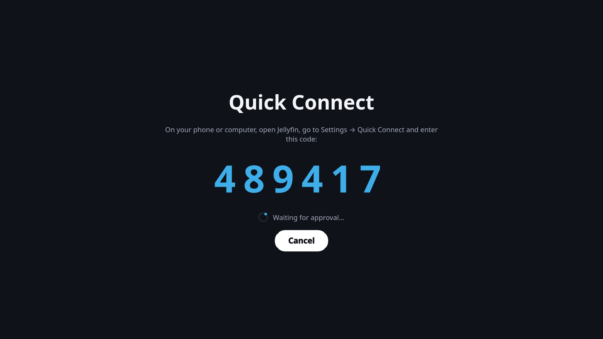
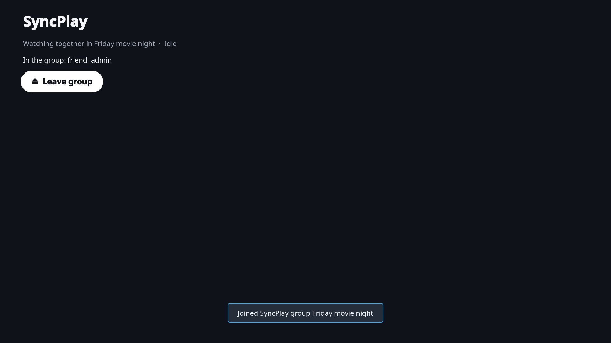

# Jellyfin TV for Linux

A fast, native 10-foot Jellyfin client for Linux TVs and HTPCs. Built with Qt Quick (QML on the GPU scene graph, no web view), driven entirely by a remote, gamepad or keyboard (or your phone), and it hands playback to a fullscreen mpv so HDR and Dolby Vision output stays intact. On KDE it picks up your accent color through Kirigami.


| | |
|---|---|
|  |  |
|  |  |
|  |  |
|  |  |

## Features

✅ works · ⚠️ depends on what your server provides · ❌ not supported yet. "Tested on" shows what each feature was verified against ("—" means covered by unit tests only): a Remux server (Jellyfin 10.11 API with AIOStreams sources) and a stock Jellyfin 10.11 server.

| Feature | Status | Notes | Tested on |
|---|---|---|---|
| **Browsing** | | | |
| Home: Continue Watching, Next Up, Favorites, libraries | ✅ | | Remux |
| Library grids with sorting, collections | ✅ | | Remux |
| Shows: seasons, Specials, episode thumbnails, watched/resume markers | ✅ | | Remux |
| Search with on-screen keyboard | ✅ | | Remux |
| Details: resume/start over, watched, favorite, More like this | ✅ | | Remux |
| Trailer playing in the background of a movie or show page, Trailer button / T key for full screen with sound | ✅ | Server trailers, else a YouTube search (yt-dlp); Settings → Trailer previews | Remux |
| **Accounts** | | | |
| Username/password login | ✅ | Token kept in the system keyring | Remux, Jellyfin |
| Quick Connect login (approve on your phone, no typing) | ✅ | Server must have Quick Connect enabled | Remux |
| Multiple accounts and servers, switch any time | ✅ | | Remux |
| **Playback** | | | |
| mpv with `gpu-next`/Vulkan, HDR10/Dolby Vision passthrough | ✅ | Needs an HDR-capable compositor (KDE Plasma 6) | — |
| Resume, progress and watched sync | ✅ | | Remux |
| Version picker with bitrate cap and per-title memory | ✅ | Most useful with multi-source servers | Remux |
| Change version during playback, keeping your position | ✅ | | Remux |
| Audio/subtitle choice: language preference, Original language (no dubs) | ✅ | | Remux |
| Audio passthrough (AC3/E-AC3/DTS/TrueHD to a receiver) | ✅ | Settings → Audio output | local mpv |
| Remote-friendly player controls (uosc) or native mpv controls | ✅ | | Remux |
| Up Next with countdown, continuing in the same player | ✅ | Uses the server's credits marker when present | Remux |
| Skip intro / recap / preview | ⚠️ | Server markers (e.g. Intro Skipper plugin) or chapters named Intro/Opening/Recap | Jellyfin (chapters) |
| Seek preview thumbnails, scrubbing with the remote | ⚠️ | Needs trickplay images on the server | Jellyfin |
| Chapters menu | ✅ | When the file has chapters | — |
| **Together and remote** | | | |
| Remote control / casting from Jellyfin apps (play, pause, seek, tracks, volume, navigate, messages) | ✅ | Settings → Allow remote control | Remux |
| SyncPlay (watch in sync with other people) | ⚠️ | Server must support SyncPlay groups (stock Jellyfin does; Remux does not) | Jellyfin |
| **System** | | | |
| Remote, gamepad and keyboard navigation | ✅ | Gamepad via SDL2 (Xbox, PlayStation, Switch, Steam Input), in menus and the player | — |
| Steam Big Picture shortcut | ✅ | | Steam |
| Flatpak with bundled mpv | ✅ | | — |
| **Not supported yet** | | | |
| Music, Live TV, photos, books | ❌ | Video only for now | |
| Subtitle search/download from the server | ❌ | | |
| Trailers | ❌ | | |

## Install

Flatpak:

```sh
flatpak remote-add --user --if-not-exists flathub https://dl.flathub.org/repo/flathub.flatpakrepo
flatpak remote-add --user --if-not-exists jellyfin-tv https://gettuh.github.io/jellyfin-tv-linux/jellyfin-tv.flatpakrepo
flatpak install --user jellyfin-tv io.github.gettuh.JellyfinTV
```

From source: `packaging/install.sh`, then run `jellyfin-tv`. Details, keys and release steps are in [jellyfin_tv/README.md](jellyfin_tv/README.md).

## License

Jellyfin TV is free software under the [GNU GPL v3 or later](LICENSE). The bundled [uosc](https://github.com/tomasklaen/uosc) in `jellyfin_tv/player/uosc/` keeps its own LGPL license.
